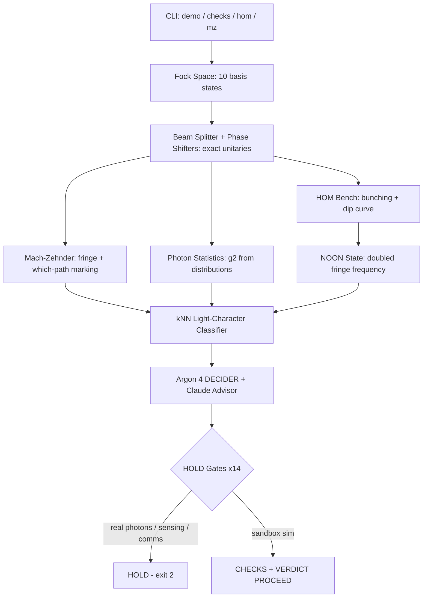
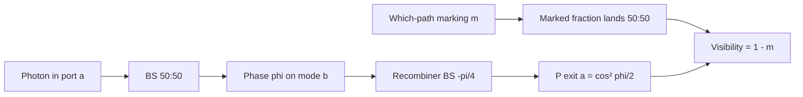
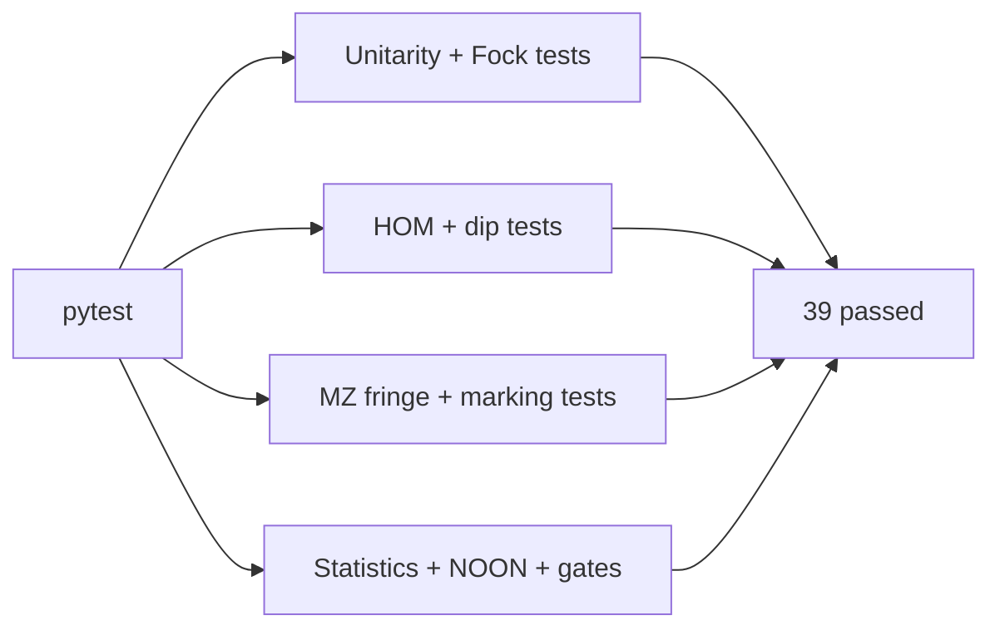
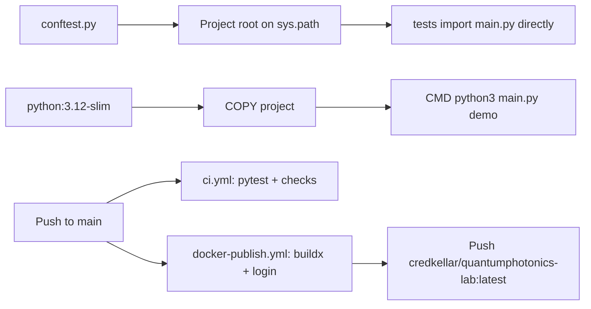

# QuantumPhotonics-Lab 🔦⚛️

**Single-Photon Optics Lab** — by Darion Kellar

QuantumPhotonics-Lab is an **educational quantum-photonics lab** in ONE pure-Python file. It builds the smallest honest stage for single-photon optics — a **truncated two-mode Fock space** (at most 3 photons, 10 basis states) — and then performs the classic experiments on it with **exact amplitudes**, not animations:

- a **beam splitter** and **phase shifters** as exact unitaries, built from creation-operator algebra (binomial expansion, no series truncation);
- the **Hong–Ou–Mandel effect**: two indistinguishable photons bunch and the coincidence probability cancels to **4.93e-32 ≈ 0**, while distinguishable photons sit at the classical **0.5000**;
- a **Mach–Zehnder interferometer** whose fringe is `cos²(φ/2)` to machine precision, with **which-path marking** priced into the visibility (1.0000 → 0.6000 at 40% marking → 0);
- **photon statistics**: coherent, single-photon Fock, and thermal distributions with **g²(0) computed from each distribution** — 1.0000, 0.0000, 2.0000;
- a **NOON state** (the HOM output itself) whose coincidence fringe runs at **twice** the single-photon frequency — phase super-resolution as arithmetic;
- and a from-scratch **kNN light-character classifier** fed entirely by numbers this lab's own benches measured.

Honest scope, stated up front: these are **exact amplitudes in a truncated toy basis** — there are no real photons, sources, fibres, or detectors here, and no number in this repo is a sensing, imaging, ranging, or communications result. Every real-world use sits behind a permanent HOLD gate (14 total). 🔒

[](https://github.com/kimanicollier44-cmyk/QuantumPhotonics-Lab/actions/workflows/ci.yml)
[](https://github.com/kimanicollier44-cmyk/QuantumPhotonics-Lab/actions/workflows/docker-publish.yml)

> ℹ️ These are the **live** workflow badges for this repo. They activate as soon as the `ci.yml` and `docker-publish.yml` files from the paste pack are pasted into `.github/workflows/` — until then they have nothing to report yet.

## 🧰 Tech Stack Badges & Full Architecture Tech Stack

### 💻 Core Programming Languages & Core Systems


- 🐍 Python 3.12, pure standard library (`math`, `hashlib`, `json`, `sys`) — zero dependencies, zero network, deterministic (double-run byte-identical)
- 🎛️ Fock-space core: two modes, basis |n_a, n_b⟩ with n_a + n_b ≤ 3 (10 states); beam-splitter unitaries built by exact binomial expansion of the transformed creation operators — unitarity error **3.33e-16**, asserted in CHECKS
- 🌊 Interference benches: HOM coincidence from the raw unitary, Mach–Zehnder fringe `cos²(φ/2)`, NOON coincidence fringe `cos²(φ)` — every headline number is computed, then asserted against its analytic value
- 🧠 TinyML kNN light-character classifier (from scratch, stdlib): single-photon / bunched-pair / coherent / thermal from (g²(0), coincidence, visibility), with every feature measured on this lab's own benches
- 🪑 Council seats: Gemini Argon 4 DECIDER (names-only, tighten-only) + Muse advisor (never overrides HOLD) + Google Flow plan-only (rendered = False, live = 0)

### ⛓️ Web3 & Infrastructure

- 🚫 **Not applicable — honestly.** No blockchain, no Web3, no tokens: the "infrastructure" in this lab is a labelled simulation of an optics bench inside one offline file. No fake badges here.

### ⚙️ Platform Support & Hardware Architecture


- 🖥️ Pure Python — runs anywhere Python 3.12+ runs (Linux, macOS, Windows), plus the `python:3.12-slim` Docker image
- 🔒 No hardware is controlled, ever: real lasers, sources, beam splitters, and detectors are permanent HOLD gates (see the gate table below)

### ⚡ Low-Level Infrastructure & Performance

- 🚫 **No low-level code — honestly.** No C, no C++, no GPU, no compiled extensions: this is one interpreted Python file on purpose, so every amplitude can be read, checked, and diffed. Performance here means exact algorithms — polynomial (binomial) construction of the splitter unitary instead of a truncated matrix exponential, and fringe scans that sample the analytic benches directly.

### 🛠️ DevOps & Build Tools


- 🐳 Docker (`python:3.12-slim`), GitHub Actions CI + Docker Publish (delivered in the paste pack)
- 🎯 Target image: `credkellar/quantumphotonics-lab:latest`
- 🧪 Tests: `pytest` (39 tests) + the built-in CHECKS suite (42 checks) in `main.py`

### ☁️ Cloud Providers

- 🚫 **None — honestly.** No cloud provider is used or needed: the lab runs fully offline on your own machine or in a local Docker container. Docker Hub appears only as the registry the publish workflow pushes the image to.

## What this does?

1. 🧮 **Builds the stage: a truncated Fock space** — two modes (a, b), every |n_a, n_b⟩ with n_a + n_b ≤ 3: **10 basis states**. Beam splitters and phase shifters conserve total photon number, so their action never leaves this basis — the truncation is *exact* for these operators, not an approximation, and the lab says so in the docstring.
2. 🔀 **Builds the beam splitter from operator algebra** — a† → cos θ·a† + sin θ·b†, b† → −sin θ·a† + cos θ·b†, substituted into (a†)^na (b†)^nb / √(na! nb!) and expanded with exact binomial (polynomial) arithmetic. The resulting unitary's error is **3.33e-16** — machine precision, asserted in CHECKS for θ = π/4, 0.3, and 1.1.
3. 👯 **Runs the Hong–Ou–Mandel effect** — |1,1⟩ into the 50:50 splitter: the two indistinguishable paths to a coincidence (both transmitted, both reflected) cancel exactly, coincidence = **4.93e-32**. The photons bunch: P(2,0) = P(0,2) = 0.5000. Distinguishable photons, priced classically as T² + R², give coincidence **0.5000** — the dip falls from there.
4. 📉 **Sweeps the HOM dip** — with a labelled Gaussian mode-overlap η(delay) = exp(−delay²/2σ²), coincidence = (1 − η²)/2 climbs 0.0000 → 0.1106 → 0.3161 → 0.4473 → 0.4908 → 0.4999 as the delay grows from 0 to 3σ; dip visibility is **1.0000**. Partial distinguishability is a computed curve, not a footnote.
5. 💎 **Runs a Mach–Zehnder interferometer** — splitter → phase φ on mode b → mirror-image recombiner. A single photon exits port a with probability **cos²(φ/2)**, matching the analytic fringe to < 1e-9 at every sampled phase, and switches fully to port b at φ = π.
6. 🏷️ **Prices which-path information** — mark a fraction m of the path and that fraction can no longer interfere: it lands 50:50 and the visibility falls to exactly **1 − m** (m = 0.4 → **0.6000**; m = 1 → **0.0000**). The phase-precision note Δφ ~ 1/(V√N) is printed next to it — **0.0100 rad** at V = 1, N = 10,000 — labelled as a counting-statistics note, never a sensor spec.
7. 🎲 **Separates light by its statistics** — coherent (Poisson), Fock |1⟩ (delta), thermal (Bose geometric), and Fock |2⟩ distributions, each carried to n = 64 so the moments are honest. g²(0) = ⟨n(n−1)⟩/⟨n⟩² is **computed from each distribution**: coherent **1.0000**, Fock |1⟩ **0.0000** (antibunched), thermal **2.0000** (bunched), Fock |2⟩ **0.5000**.
8. 🚀 **Builds the NOON state for free** — the HOM output (|0,2⟩ − |2,0⟩)/√2 *is* the N = 2 NOON state. The phase lands twice on its |0,2⟩ arm, so the coincidence fringe after the recombiner is **cos²(φ)**: **2 fringe minima** in [0, 2π) where the single photon shows **1** — phase super-resolution, computed from the same two unitaries.
9. 🏷️ **Classifies light character with kNN** — features (g²(0), HOM coincidence, fringe visibility) are *measured on this lab's own benches* for four scenarios — heralded single photon, attenuated laser, thermal lamp, bunched photon pair — and a from-scratch kNN over a model-labelled grid returns single-photon / coherent / thermal / bunched-pair, agreeing with the lab's character model on every bench row.
10. 🔒 **Refuses the real world, by name** — 14 HOLD gates (real sources, quantum comms, sensing, LiDAR, medical imaging, detector certification, QRNG, surveillance, weapons guidance, …) return exit code 2, with Argon 4 DECIDER (sha256 trace), Muse advisor, Google Flow plan-only, and a built-in CHECKS suite (42 checks).

## 🗺️ How it works — diagram per script

### `main.py` — the whole lab



### Fock-space optics core — exact unitaries

```mermaid
flowchart LR
    A[Basis: na + nb ≤ 3, 10 states] --> B[Creation-operator images]
    B --> C[Binomial polynomial expansion]
    C --> D[Beam-splitter unitary U]
    A --> E[Phase shifter: diagonal e^{i phi n}]
    D --> F{Unitarity check}
    E --> F
    F -->|error 3.33e-16| G[Exact inside the truncation]
```

### HOM bench — bunching and the dip

```mermaid
flowchart TD
    A[Input |1,1⟩] --> B[50:50 beam splitter]
    B --> C[P 1,1 coincidence = 4.93e-32]
    B --> D[P 2,0 = P 0,2 = 0.5: bunching]
    E[Distinguishable photons] --> F[Classical T² + R² = 0.5]
    G[Delay sweep: eta = exp delay curve] --> H[Coincidence 1 - eta² over 2]
    H --> I[Dip visibility 1.0000]
```

### Mach–Zehnder bench — fringe and marking



### Photon statistics bench — g²(0) from the distributions

```mermaid
flowchart TD
    A[Mean photon number 2.0] --> B[Coherent: Poisson]
    A --> C[Fock |1⟩ and |2⟩: delta]
    A --> D[Thermal: Bose geometric]
    B --> E[g2 = ⟨n n-1⟩ / ⟨n⟩² computed]
    C --> E
    D --> E
    E --> F[1.0000 / 0.0000 / 2.0000 / 0.5000]
```

### NOON bench — super-resolution fringe

```mermaid
flowchart LR
    A[HOM output = NOON state] --> B[Phase phi lands twice: e^{i 2 phi}]
    B --> C[Recombiner]
    C --> D[Coincidence = cos² phi]
    D --> E[2 minima in 0..2pi vs 1 for one photon]
```

### `tests/test_main.py` — verification



### `conftest.py` + Dockerfile + CI flow



## Why is this cool?

1. 👯 The HOM cancellation is **exact, not simulated luck**: the coincidence amplitude is a difference of two paths and the lab computes it to 4.93e-32 — the most famous zero in quantum optics, from ten basis states and one unitary.
2. 🔀 The beam splitter is **derived, not downloaded**: creation-operator substitution and binomial expansion build the unitary, so the √2 factors in |2,0⟩ amplitudes come from the algebra, not from a lookup table.
3. 📉 The HOM dip is a **curve with a shape**: delay in, coincidence out, visibility 1.0000 — you can watch distinguishability eat the interference point by point.
4. 🏷️ Which-path marking is **priced, not preached**: visibility = 1 − m falls out of a two-line mixture model and is asserted at m = 0, 0.4, and 1.
5. 🎲 g²(0) is **computed, never quoted**: the code sums ⟨n(n−1)⟩/⟨n⟩² over each distribution and *discovers* 1, 0, 2, and 1/2 — the whole coherent/Fock/thermal taxonomy from one formula.
6. 🚀 The NOON state is **the HOM output wearing a second hat**: the same state that proves bunching also doubles the fringe frequency — two flagship effects, one vector.
7. 🪞 The recombiner is the **mirror image** of the first splitter (the inverse unitary), which is why the fringe reads cos²(φ/2) — a detail most toy demos get wrong and this one asserts.
8. 🧠 The classifier **eats what the lab cooks**: every kNN feature is measured on the lab's own benches, so the ML section can be audited back to a unitary, a distribution, or a fringe.
9. 🎯 Deterministic end to end: no randomness anywhere — every number is an analytic computation, so run it twice and get byte-identical output. A photonics bench you can diff.
10. 🔒 The honesty is **load-bearing**: the docstring, the demo's first section, and HOLD gate #14 all state the truncation is a toy — the lab teaches real optics logic precisely by refusing to impersonate a real bench.

## What problems this solves?

1. ❌ **Problem:** HOM is usually shown as a cartoon dip with no numbers behind it. ✅ **Solution:** The coincidence is computed from the Fock unitary (4.93e-32), the distinguishable floor from T² + R² (0.5000), and the dip between them as an explicit delay curve.
2. ❌ **Problem:** Toy beam splitters often get the two-photon amplitudes wrong (the √2 bunching factors). ✅ **Solution:** The unitary is built by creation-operator algebra and its unitarity is asserted to 3.33e-16 — wrong factors cannot survive the check.
3. ❌ **Problem:** "Truncated Fock space" sounds like an approximation nobody quantifies. ✅ **Solution:** The lab proves the operators conserve photon number, so nothing leaks: inside ≤ 3 photons the results are exact, and the boundary is stated everywhere.
4. ❌ **Problem:** Which-path / visibility trade-offs are taught as slogans ("information destroys interference"). ✅ **Solution:** A marking fraction m is carried through the fringe math and the visibility lands on 1 − m, asserted at three values of m.
5. ❌ **Problem:** g²(0) values (1, 0, 2) are memorised as trivia. ✅ **Solution:** Each is computed from its distribution's factorial moment — change the distribution and the number moves, which is the actual lesson.
6. ❌ **Problem:** NOON states and super-resolution are usually introduced with apparatus the reader can't run. ✅ **Solution:** The NOON state is the HOM output the reader just computed; its doubled fringe (2 minima vs 1) is counted by the code.
7. ❌ **Problem:** Phase-estimation claims inflate a fringe into a sensor. ✅ **Solution:** The Δφ ~ 1/(V√N) line is printed as a labelled counting-statistics note, and `quantum_sensing_claim` / `interference_as_measurement_claim` are permanent HOLD gates.
8. ❌ **Problem:** Photonics demos quietly imply a product is next — a source, a detector, a network. ✅ **Solution:** 14 named HOLD gates return exit code 2 for every source, detector, comms, sensing, imaging, and product claim, forever.
9. ❌ **Problem:** ML classifiers in teaching repos train on invented data. ✅ **Solution:** The kNN's scenarios take g² from the statistics bench, coincidence from the HOM bench, and visibility from the MZ/NOON benches — every feature traces to a computation in the same file.
10. ❌ **Problem:** Simulation output drifts between runs and machines, so numbers in READMEs rot. ✅ **Solution:** Zero randomness, zero wall-clock, zero network: the demo is byte-identical between runs, and every README number is re-asserted by CHECKS 42/42.

## How to install this?

1. 📋 Clone or download this project folder.
2. 🐍 Make sure Python 3.12+ is installed: `python3 --version`
3. ▶️ Run the full demo + checks (no arguments needed):

```bash
python3 main.py
```

4. 🧪 Run the test suite:

```bash
pip install pytest
python3 -m pytest -q
```

5. 🎛️ Try the other commands:

```bash
python3 main.py checks    # 42 built-in checks
python3 main.py hom       # HOM coincidence, dip curve, NOON amplitudes (JSON)
python3 main.py mz        # Mach-Zehnder fringe, visibilities, precision note (JSON)
python3 main.py stats     # photon distributions: means + g2(0) (JSON)
python3 main.py noon      # NOON fringe + minima count (JSON)
python3 main.py classify  # kNN light-character classifier report
python3 main.py brains    # Argon 4 + Muse + Flow seats
python3 main.py holds     # list all 14 HOLD gates
python3 main.py hold-demo # exits 2 - gated actions stay HOLD
```

6. 🐳 Or run it in Docker:

```bash
docker build -t credkellar/quantumphotonics-lab:latest .
docker run --rm credkellar/quantumphotonics-lab:latest
```

## Requirements

- 🐍 Python 3.12 or newer
- 📦 Dependencies: **none** (standard library only)
- 🌐 Network: **none** — fully offline
- 🧪 For tests only: `pytest`
- 🐳 Optional: Docker

## FULL project structure tree

```text
quantumphotonics-lab/
├── main.py                  # the whole lab: Fock space, beam splitter, phase shifters, HOM, Mach-Zehnder, statistics, NOON, classifier, seats, HOLD gates
├── conftest.py              # puts the project root on sys.path for tests
├── tests/
│   └── test_main.py         # 39 pytest tests: unitarity, HOM, MZ, statistics, NOON, classifier, gates, determinism
├── assets/
│   └── cover.png            # README cover image (2736 x 912)
├── Dockerfile               # python:3.12-slim, runs the demo
├── .gitignore               # __pycache__/, .pytest_cache/, *.pyc
└── README.md                # this file
```

> 📦 Delivered separately as paste packs (not in this tree): `.github/workflows/ci.yml` + `docker-publish.yml`, and the Docker Hub pack (100-char description, 350-char About, overview, categories).

## 🔒 HOLD gates — all 14, permanent

| # | Gate | What stays held |
|---|------|-----------------|
| 1 | `real_photon_source_claim` | No claim of a real single-photon source; the Fock states here are vectors in a toy basis |
| 2 | `quantum_communication_claim` | No quantum-communication, QKD, or network use; interference arithmetic is not a channel |
| 3 | `quantum_sensing_claim` | No sensing or metrology product claim; the phase-precision line is a textbook shot-noise note |
| 4 | `lidar_ranging_claim` | No LiDAR, ranging, or remote-sensing use of these amplitudes |
| 5 | `medical_imaging_claim` | No medical, diagnostic, or biological imaging claim |
| 6 | `detector_certification_claim` | No certifying real detectors, efficiencies, dark counts, or timing jitter |
| 7 | `random_number_generation_claim` | No quantum random-number generation claim from simulated statistics |
| 8 | `surveillance_claim` | No surveillance, identification, or tracking use |
| 9 | `weapons_guidance_claim` | No weapons, guidance, targeting, or military use |
| 10 | `commercial_product_claim` | No commercial photonic product, component, or performance claim |
| 11 | `hardware_control_claim` | No control of real lasers, optics benches, sources, or detectors |
| 12 | `interference_as_measurement_claim` | A simulated fringe is not a measurement of a real phase, length, or field |
| 13 | `entanglement_certification_claim` | HOM bunching and NOON amplitudes in a truncated basis do not certify real entanglement |
| 14 | `truncated_model_as_device_claim` | A ≤3-photon truncated toy must never be presented as a device model or specification |

🧑‍⚖️ **Council seats:** Gemini Argon 4 Extended Thinking — DECIDER (names-only, tighten-only, MAP → MODEL → STRESS → DECIDE, sha256 trace, `can_override_hold = False`) · Muse — advisor (`can_override_hold = False`) · Google Flow — plan-only (`rendered = False`, `live = 0`).

✅ **Verification:** pytest **39 passed** (project + clean copy) · built-in CHECKS **42/42** · double-run output **byte-identical** · `hold-demo` exits **2** · `main.py` **817 lines**, pure stdlib, zero network.

## 🧒 5th-grade English section

Imagine light as tiny balls called **photons** that can do something no ordinary ball can: be in two places at once and argue with themselves. 🔦

- A **beam splitter** is a half-silvered mirror — like a coin flip for a photon. One photon can go through or bounce off, and until somebody looks, it sort of does **both**. 🪞
- Now send **two** photons into the mirror at the same time, one from each side. You would expect them to sometimes leave through different doors. But if the photons are perfect twins, they **always leave together through the same door** — every single time. Scientists call this the **Hong–Ou–Mandel effect**, and this lab does the math that makes the "different doors" answer exactly zero. 👯
- If the twins arrive at **different times**, the trick stops working, and they leave through different doors half the time. The lab draws that change as a little valley called the **dip**. 📉
- A **Mach–Zehnder** is a photon obstacle course: split, travel two paths, join back up. Depending on how much longer one path is, the photon's two halves can **help each other or cancel each other** — that is the wavy pattern called a fringe. But if you secretly **mark** which path it took, the waves stop arguing and the fringe fades away. 🏷️
- Light also has **personalities** you can measure by counting: laser light counts like raindrops (random but steady), a single-photon source sends them one at a time like a careful turnstile, and lamp light sends them in bunches like friends arriving together. One number — called g² — tells them apart, and this lab **computes** it. 🎲
- Take the two photons that left together and send them around the obstacle course as a pair: their wave wiggles **twice as fast** as a single photon's. That pair is called a **NOON state**, and the lab counts the wiggles to prove it. 🚀
- This project is a **pretend lab on a computer**. It does not make real photons or measure real things. It helps you learn why light's strangest tricks are not magic — they are arithmetic. 💻

---

MIT © 2026 Darion Kellar · QuantumPhotonics-Lab — educational simulation only 🔦
